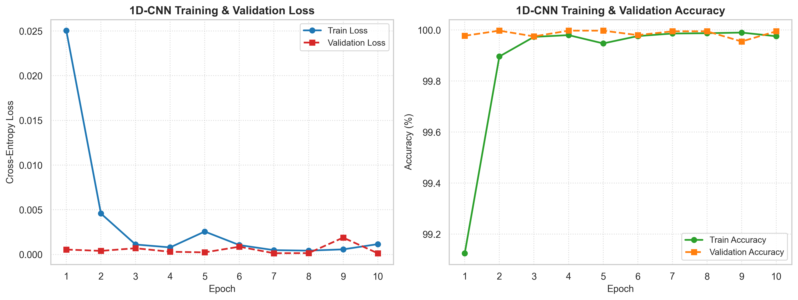
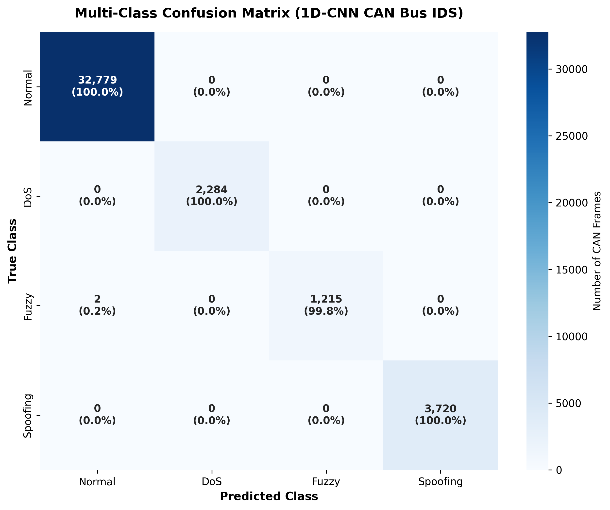

# Anomaly and Attack Detection in Industrial and In-Vehicle Networks Using Deep Learning


---

## Overview

Modern vehicles and industrial control systems increasingly rely on the **Controller Area Network (CAN)** bus protocol for real-time communication between Electronic Control Units (ECUs). Because the standard CAN protocol lacks built-in authentication, encryption, and message integrity mechanisms, in-vehicle networks are vulnerable to packet injection attacks such as **Denial-of-Service (DoS)**, **Fuzzy Flooding**, and **RPM/Gear Spoofing**.

This project implements an end-to-end **1D Convolutional Neural Network (1D-CNN)** Intrusion Detection System (IDS) in PyTorch that classifies raw CAN bus traffic into four categories (`Normal`, `DoS`, `Fuzzy`, and `Spoofing`) by combining spatial payload characteristics with temporal message frequency analysis.

---

## Project Structure

```text
CAN-Bus-Attack-Detection/
├── data/                   # Raw HCRL Car-Hacking CSV datasets (ignored by Git)
│   ├── DoS_dataset.csv
│   ├── Fuzzy_dataset.csv
│   ├── RPM_dataset.csv
│   └── gear_dataset.csv
├── src/
│   ├── preprocess.py       # Variable-DLC CSV parser, feature engineering, & normalization
│   ├── model.py            # 1D-CNN architecture & CUDA/CPU device detection
│   └── train_eval.py       # Stratified 80/20 split, 10-epoch training, metrics & plots
├── results/                # Tracked evaluation outputs & high-resolution figures
│   ├── metrics.txt
│   ├── confusion_matrix.png
│   └── training_curves.png
├── requirements.txt        # Python dependencies
├── .gitignore              # Excludes venv, cache, and raw CSV files while tracking results/
└── README.md               # Project documentation
```

---

## Dataset & Feature Engineering

### HCRL Car-Hacking Dataset

The model is evaluated on the public **HCRL Car-Hacking Dataset** (Korea University), which captures real OBD-II CAN bus traffic under four injection scenarios:

- `DoS_dataset.csv`: High-priority dominant CAN ID (`0x0000`) flood injected every 0.3 ms.
- `Fuzzy_dataset.csv`: Randomized CAN IDs and data payloads injected every 0.5 ms.
- `RPM_dataset.csv`: Spoofed engine RPM frames injected every 1 ms.
- `gear_dataset.csv`: Spoofed drive gear frames injected every 1 ms.

### Preprocessing Pipeline (`src/preprocess.py`)

Raw HCRL CSV files contain no header row and have variable column counts whenever `DLC < 8`:

```text
Timestamp, CAN_ID (hex), DLC (int), DATA[0..DLC-1] (hex), Flag ('R' = Normal, 'T' = Attack)
```

`src/preprocess.py` safely extracts the last column as `Flag`, right-pads payloads having `DLC < 8` with `'00'` bytes, and engineers three core feature groups (forming a 10-dimensional input vector per frame):

1. **Normalized `CAN_ID`**: Converted from hexadecimal to integer and scaled to `[0, 1]`.
2. **Normalized 8-Byte Payload (`DATA[0..7]`)**: Converted from hexadecimal bytes (`0–255`) to integers and normalized to `[0, 1]`.
3. **Message Frequency / Time Delta ($\Delta t$)**: Elapsed time (`delta_t`) between consecutive frames sharing the exact same `CAN_ID`, capturing anomalous injection intervals.

---

## Deep Learning Architecture (`src/model.py`)

The `CAN1DCNN` architecture applies 1D convolutions over the 10-element feature vector `(1, 10)`:

- **Conv Block 1:** `Conv1d(1 -> 64, kernel_size=3, padding=1)` + `BatchNorm1d` + `ReLU`
- **Conv Block 2:** `Conv1d(64 -> 128, kernel_size=3, padding=1)` + `BatchNorm1d` + `ReLU` + `MaxPool1d(2)`
- **Conv Block 3:** `Conv1d(128 -> 128, kernel_size=3, padding=1)` + `BatchNorm1d` + `ReLU`
- **Classifier Head:** `Flatten` -> `Linear(640 -> 128)` -> `ReLU` -> `Dropout(0.2)` -> `Linear(128 -> 64)` -> `ReLU` -> `Linear(64 -> 4)`

---

## Quick Start & Execution

### 1. Environment Setup

```bash
python -m venv venv
# Windows PowerShell:
.\venv\Scripts\Activate.ps1
# Linux / macOS:
# source venv/bin/activate

pip install -r requirements.txt
```

### 2. Run Training and Evaluation

By default, `src/train_eval.py` loads `50,000` rows per CSV file (`200,000` total frames) for fast execution, performs an 80/20 stratified split, trains for 10 epochs, and outputs all evaluation artifacts to `results/`:

```bash
python src/train_eval.py
```

To train on the **entire dataset** (all ~16.5 million frames), pass `--sample_size 0`:

```bash
python src/train_eval.py --sample_size 0 --epochs 10 --batch_size 512
```

---

## Experimental Results

Evaluating the 1D-CNN model on the 20% stratified test set (`40,000` frames out of `200,000` sampled frames across all four datasets) after 10 epochs yields:

| Class            | Precision   | Recall      | F1-Score   | Support    |
|:---------------- |:-----------:|:-----------:|:----------:|:----------:|
| **Normal**       | 99.99%      | 100.00%     | 100.00%    | 32,779     |
| **DoS**          | 100.00%     | 100.00%     | 100.00%    | 2,284      |
| **Fuzzy**        | 100.00%     | 99.84%      | 99.92%     | 1,217      |
| **Spoofing**     | 100.00%     | 100.00%     | 100.00%    | 3,720      |
| **Weighted Avg** | **100.00%** | **100.00%** | **99.99%** | **40,000** |
| **Macro Avg**    | **100.00%** | **99.96%**  | **99.98%** | **40,000** |

Evaluation metrics and visualizations are saved automatically in `results/`:

- **`results/metrics.txt`**: Full classification report (Accuracy, Precision, Recall, F1-Score), confusion matrix table, and epoch-by-epoch training history.
- **`results/confusion_matrix.png`**: High-resolution (300 DPI) multi-class confusion matrix heatmap.
- **`results/training_curves.png`**: High-resolution (300 DPI) training and validation loss/accuracy curves across epochs.



